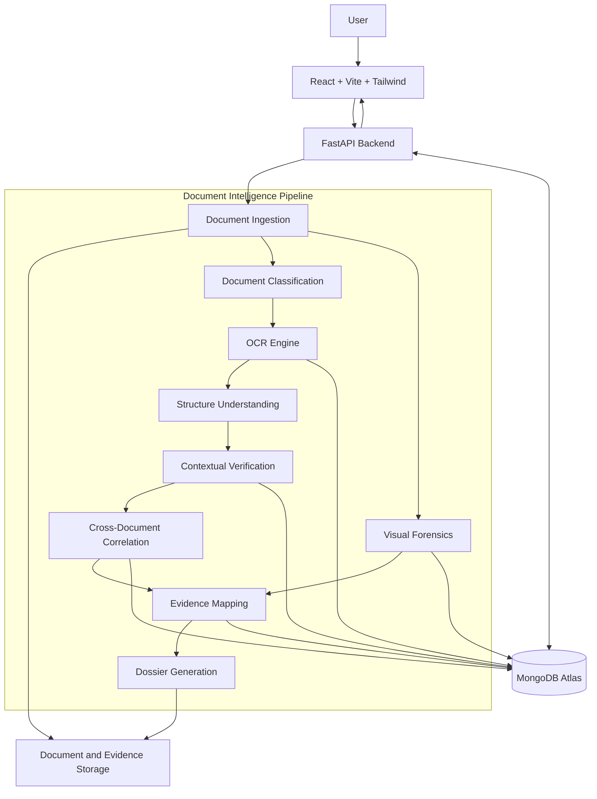

# VERITAS
## Technical Architecture and Implementation Design

**Version:** 1.0  
**Date:** 6 November 2026  
**Architecture:** Modular monolith with independent processing modules  
**Deployment:** Free-tier, CPU-first  
**Database:** MongoDB Atlas

---

# 1. Architecture Overview

VERITAS follows a modular architecture in which document ingestion, OCR, image forensics, contextual analysis, cross-document correlation, evidence management and report generation operate as independent modules.

The frontend communicates with the FastAPI backend through REST APIs.

MongoDB stores structured investigation data, while original PDFs and generated evidence images are handled separately through file storage.

## 1.1 High-Level Architecture



# 2. Technology Stack

## 2.1 Frontend

| Technology | Purpose |
|---|---|
| React | Component-based interface |
| Vite | Development server and build |
| TypeScript | Type safety |
| Tailwind CSS | Styling |
| React Router | Page navigation |
| Axios | Backend communication |
| Recharts | Investigation analytics |
| React Flow | Evidence relationship graph |
| Lucide React | Icons |

### Frontend responsibilities

- Investigation dashboard.
- Document upload interface.
- Processing status.
- Extracted information viewer.
- Document comparison.
- Visual evidence inspection.
- Investigation graph.
- Dossier download.

Frontend must never independently determine whether a document is manipulated. It displays backend-generated findings and evidence.

## 2.2 Backend

| Technology | Purpose |
|---|---|
| Python 3.11 | Main language |
| FastAPI | REST API framework |
| Pydantic | Data validation |
| PyMongo | MongoDB integration |
| Uvicorn | ASGI server |
| Python-Multipart | File uploads |

Use a modular backend instead of placing all functionality in one large Python file.

## 2.3 OCR and Document Processing

### PyMuPDF

Purpose:
- Read PDFs.
- Extract digital text.
- Extract page dimensions.
- Render scanned PDF pages into images.
- Obtain text block coordinates.
- Preserve page-level references.

Documentation: https://pymupdf.readthedocs.io/

### PaddleOCR

Purpose:
- Recognize printed text.
- Extract OCR bounding boxes.
- Return recognized text and confidence values.
- Process scanned document images.

Repository: https://github.com/PaddlePaddle/PaddleOCR

### Tesseract OCR

Optional alternative for a lightweight CPU-oriented pipeline.

Repository: https://github.com/tesseract-ocr/tesseract

**Implementation decision:** Start with one primary OCR engine. Do not integrate multiple OCR engines simultaneously unless testing demonstrates a meaningful improvement.

## 2.4 Computer Vision

### OpenCV

Purpose:
- Image preprocessing.
- Grayscale conversion.
- Noise analysis.
- Edge detection.
- Contour detection.
- Local image comparison.
- Region highlighting.
- Basic image consistency analysis.

### Pillow

Purpose:
- Image loading.
- Image conversion.
- Cropping.
- Resizing.
- Annotated evidence image generation.

### Proposed forensic methods

| Method | Purpose |
|---|---|
| Error Level Analysis (ELA) | Examine JPEG compression differences |
| Edge analysis | Identify unusual local boundaries |
| Color distribution | Compare image regions |
| Font/spacing analysis | Identify layout inconsistencies |
| Alignment analysis | Identify unusual text placement |
| Metadata inspection | Examine available document metadata |

Important limitations:

- ELA is an indicator, not proof of manipulation.
- Metadata can be modified or removed.
- Different compression levels can produce false positives.
- Scanned and photographed documents require different analysis.
- Font analysis is limited when text is rasterized.

Do not claim reliable manipulation detection from one forensic method alone.

## 2.5 Contextual Intelligence

| Library | Purpose |
|---|---|
| spaCy | Entity extraction |
| RapidFuzz | Fuzzy string matching |
| Python Decimal | Financial comparisons |
| Python datetime | Date validation |
| Pydantic | Structured findings |

Examples:

**Name comparison**

Compare names across identity documents and applications while accounting for minor spelling variations.

**Amount comparison**

Compare salary values between salary slips and employment letters.

**Date verification**

Check date relationships and expiry validity.

**Address comparison**

Normalize and compare address components.

Contextual analysis should distinguish:

- Exact match.
- Approximate match.
- Mismatch.
- Missing information.
- Not comparable.

A mismatch is not automatically fraud.

## 2.6 AI Reasoning

The MVP should not depend on a paid LLM API.

Use evidence-backed investigation logic to produce structured findings.

Optional future extension:

A locally hosted open-source LLM can turn verified findings into natural-language explanations.

Any LLM-generated explanation must receive only actual extracted evidence and must not invent supporting facts.

---

# 3. Repository Structure

Recommended repository:

```text
veritas/
│
├── frontend/
│   ├── public/
│   ├── src/
│   │   ├── assets/
│   │   ├── components/
│   │   │   ├── common/
│   │   │   ├── dashboard/
│   │   │   ├── documents/
│   │   │   ├── forensic/
│   │   │   ├── evidence/
│   │   │   └── reports/
│   │   │
│   │   ├── pages/
│   │   │   ├── Dashboard.tsx
│   │   │   ├── NewInvestigation.tsx
│   │   │   ├── InvestigationDetails.tsx
│   │   │   ├── DocumentViewer.tsx
│   │   │   ├── EvidenceExplorer.tsx
│   │   │   └── Reports.tsx
│   │   │
│   │   ├── services/
│   │   │   └── api.ts
│   │   │
│   │   ├── hooks/
│   │   ├── types/
│   │   ├── utils/
│   │   ├── App.tsx
│   │   └── main.tsx
│   │
│   ├── package.json
│   └── vite.config.ts
│
├── backend/
│   ├── app/
│   │   ├── main.py
│   │   ├── config.py
│   │   ├── database.py
│   │   │
│   │   ├── api/
│   │   │   ├── investigations.py
│   │   │   ├── documents.py
│   │   │   ├── analysis.py
│   │   │   ├── evidence.py
│   │   │   └── reports.py
│   │   │
│   │   ├── services/
│   │   │   ├── ingestion_service.py
│   │   │   ├── classification_service.py
│   │   │   ├── extraction_service.py
│   │   │   ├── structure_service.py
│   │   │   ├── contextual_service.py
│   │   │   ├── correlation_service.py
│   │   │   ├── forensic_service.py
│   │   │   ├── evidence_service.py
│   │   │   └── report_service.py
│   │   │
│   │   ├── engines/
│   │   │   ├── pdf_engine.py
│   │   │   ├── ocr_engine.py
│   │   │   ├── image_engine.py
│   │   │   ├── ela_engine.py
│   │   │   ├── metadata_engine.py
│   │   │   └── matching_engine.py
│   │   │
│   │   ├── models/
│   │   │   ├── investigation.py
│   │   │   ├── document.py
│   │   │   ├── anomaly.py
│   │   │   └── evidence.py
│   │   │
│   │   ├── utils/
│   │   │   ├── file_validation.py
│   │   │   ├── image_utils.py
│   │   │   ├── text_normalizer.py
│   │   │   └── hashing.py
│   │   │
│   │   └── schemas/
│   │       ├── investigation.py
│   │       ├── document.py
│   │       └── finding.py
│   │
│   ├── tests/
│   ├── requirements.txt
│   └── .env.example
│
├── storage/
│   ├── uploads/
│   ├── processed/
│   ├── evidence/
│   └── reports/
│
├── datasets/
│   └── README.md
│
├── docs/
│   ├── PRD.md
│   └── ARCHITECTURE.md
│
├── .gitignore
└── README.md
```

The storage directories are for local development. Production storage must be configured separately.

---

# 4. Database Architecture – MongoDB Atlas

Use MongoDB as the primary structured database.

Recommended database name:

`veritas_db`

## 4.1 Collections

1. investigations
2. documents
3. anomalies
4. relationships
5. audit_logs

For the initial MVP, extracted fields can be embedded in their associated document record.

## 4.2 Investigations Collection

Example:

```json
{
  "_id": "INV-0001",
  "title": "Financial Document Investigation",
  "status": "processing",
  "document_ids": [
    "DOC-0001",
    "DOC-0002"
  ],
  "created_at": "2026-11-06T10:00:00Z",
  "updated_at": "2026-11-06T10:10:00Z",
  "summary": null
}
```

## 4.3 Documents Collection

```json
{
  "_id": "DOC-0001",
  "investigation_id": "INV-0001",
  "filename": "salary_slip.pdf",
  "file_type": "application/pdf",
  "sha256": "actual-file-hash",
  "document_type": "salary_slip",
  "storage_key": "uploads/DOC-0001.pdf",
  "processing_status": "completed",
  "pages": [
    {
      "page_number": 1,
      "width": 595,
      "height": 842,
      "fields": [
        {
          "field_name": "employee_name",
          "value": "Example Person",
          "confidence": 0.98,
          "source": {
            "page": 1,
            "bbox": [100, 150, 300, 175],
            "coordinate_system": "pdf_points"
          }
        }
      ]
    }
  ]
}
```

The example values illustrate the schema only; they are not analysis results.

## 4.4 Anomalies Collection

```json
{
  "_id": "ANO-0001",
  "investigation_id": "INV-0001",
  "category": "cross_document_mismatch",
  "severity": "medium",
  "title": "Salary value discrepancy",
  "description": "The extracted salary values differ.",
  "evidence": [
    {
      "document_id": "DOC-0001",
      "page": 1,
      "field": "monthly_salary",
      "value": "45000",
      "bbox": [100, 200, 220, 230]
    },
    {
      "document_id": "DOC-0002",
      "page": 1,
      "field": "monthly_salary",
      "value": "50000",
      "bbox": [100, 250, 220, 280]
    }
  ],
  "detection_method": "decimal_field_comparison",
  "confidence": null,
  "status": "requires_review",
  "created_at": "2026-11-06T10:30:00Z"
}
```

Actual anomaly records must be created only when the corresponding processing and comparison have run successfully.

## 4.5 Relationships Collection

```json
{
  "_id": "REL-0001",
  "investigation_id": "INV-0001",
  "source_type": "document_field",
  "source_id": "DOC-0001",
  "target_type": "document_field",
  "target_id": "DOC-0002",
  "relationship_type": "conflicting_value",
  "anomaly_id": "ANO-0001"
}
```

## 4.6 Audit Logs Collection

```json
{
  "_id": "LOG-0001",
  "investigation_id": "INV-0001",
  "document_id": "DOC-0001",
  "event": "ocr_completed",
  "timestamp": "2026-11-06T10:15:00Z",
  "status": "success",
  "details": {
    "pages_processed": 1
  }
}
```

Use actual timestamps and processing information.

## 4.7 Database Indexes

Recommended indexes:

- investigations: created_at
- documents: investigation_id
- anomalies: investigation_id
- relationships: investigation_id
- audit_logs: investigation_id and timestamp

Use unique indexes for stable document and investigation identifiers.

---

# 5. Document Processing Pipeline

## Stage 1: Ingestion

Input:
- PDF
- PNG
- JPG
- JPEG

Processing:

1. Validate extension and actual file signature.
2. Enforce file size and page count limits.
3. Generate document ID.
4. Calculate SHA-256 hash.
5. Preserve original file.
6. Create MongoDB document record.

Output: Registered document.

## Stage 2: Document Classification

Extract available text and basic image characteristics.

Determine likely document category using transparent classification logic.

Possible categories:

- Identity proof
- Bank statement
- Salary slip
- Employment letter
- Application form
- Other

Store classification result and confidence.

If uncertain, return `unknown` or `needs_review`.

## Stage 3: OCR and Extraction

For digital PDFs:

- First attempt native text extraction through PyMuPDF.
- Extract text blocks and their positions.

For scanned PDFs:

- Render pages to images.
- Pass images through PaddleOCR.

For image uploads:

- Preprocess the image.
- Execute OCR.

Output structure:

```json
{
  "document_id": "DOC-0001",
  "page": 1,
  "fields": [
    {
      "name": "employee_name",
      "value": "Example Person",
      "confidence": 0.98,
      "bbox": [100, 100, 300, 130]
    }
  ]
}
```

Do not silently treat OCR confidence as field correctness.

## Stage 4: Structure Understanding

Organize extracted content into:

- Document type.
- Sections.
- Fields.
- Tables where supported.
- Page references.
- Bounding boxes.

Maintain field provenance.

## Stage 5: Visual Forensic Analysis

Run actual image-processing algorithms.

Suggested processing sequence:

```text
Original Document Page
        |
        v
Image Preprocessing
        |
        v
Metadata Inspection
        |
        v
Image and Edge Analysis
        |
        v
Compression Analysis (where applicable)
        |
        v
Region-Level Examination
        |
        v
Evidence Image Generation
```

Store:

- Detection method.
- Input document.
- Page number.
- Region coordinates.
- Analysis output.
- Limitations.

Do not automatically classify a visual indicator as confirmed manipulation.

## Stage 6: Contextual Verification

Apply document-specific checks.

Examples:

```text
date_of_birth < issue_date

issue_date < expiry_date

subtotal + tax = total_amount

declared_salary == extracted_salary
```

These checks are examples and must only run when the relevant fields and document semantics are available.

## Stage 7: Cross-Document Correlation

Group documents under the same investigation.

Normalize extracted values.

Examples:

```text
Document A: Applicant Name
Document B: Applicant Name

Document A: Monthly Salary
Document B: Monthly Salary

Document A: Residential Address
Document B: Residential Address
```

Use:

- Exact comparison.
- Normalized comparison.
- Fuzzy matching.
- Numeric comparison.
- Date comparison.

Each comparison must record the actual source values.

## Stage 8: Evidence Mapping

Associate each finding with its source.

Evidence object:

```json
{
  "document_id": "DOC-0001",
  "page_number": 1,
  "bbox": [100, 200, 300, 240],
  "source_field": "monthly_salary",
  "extracted_value": "45000",
  "detection_method": "cross_document_comparison"
}
```

Coordinates must be stored in a defined coordinate system.

For example:

- PyMuPDF native text coordinates: PDF page points.
- OCR coordinates: rendered image pixels.

Store image dimensions and transformation information when converting between coordinate systems.

This ensures that evidence overlays align with the original document.

## Stage 9: Dossier Generation

Use ReportLab.

Generate:

- Investigation summary.
- Document inventory.
- Extracted information.
- Cross-document comparisons.
- Visual forensic findings.
- Evidence images.
- Anomaly explanations.
- Confidence information.
- Limitations.

Every finding must reference its source document and page.

---

# 6. API Architecture

Base URL:

`/api/v1`

## 6.1 Investigation APIs

| Method | Endpoint | Purpose |
|---|---|---|
| POST | /investigations | Create investigation |
| GET | /investigations | List investigations |
| GET | /investigations/{id} | Investigation details |
| DELETE | /investigations/{id} | Delete investigation |

## 6.2 Document APIs

| Method | Endpoint | Purpose |
|---|---|---|
| POST | /investigations/{id}/documents | Upload documents |
| GET | /investigations/{id}/documents | List documents |
| GET | /documents/{id} | Document details |
| GET | /documents/{id}/pages/{page} | Original page preview |

## 6.3 Analysis APIs

| Method | Endpoint | Purpose |
|---|---|---|
| POST | /investigations/{id}/analyze | Start analysis |
| GET | /investigations/{id}/status | Processing status |
| GET | /documents/{id}/extraction | Extracted fields |
| GET | /documents/{id}/forensics | Visual findings |
| GET | /investigations/{id}/correlations | Cross-document results |

## 6.4 Evidence APIs

| Method | Endpoint | Purpose |
|---|---|---|
| GET | /investigations/{id}/anomalies | Findings |
| GET | /anomalies/{id} | Finding details |
| GET | /anomalies/{id}/evidence | Supporting evidence |
| GET | /investigations/{id}/relationships | Evidence graph |

## 6.5 Report APIs

| Method | Endpoint | Purpose |
|---|---|---|
| POST | /investigations/{id}/report | Generate dossier |
| GET | /investigations/{id}/report | Retrieve report metadata |
| GET | /reports/{id}/download | Download report |

The API must return appropriate error responses for unsupported formats, oversized documents, processing failures and missing resources.

---

# 7. Frontend Architecture

## Page 1: Dashboard

Display:

- Total investigations.
- Documents processed.
- Findings requiring review.
- Recent investigations.
- Investigation status.

All metrics must come from actual database records.

## Page 2: New Investigation

Features:

- Investigation title.
- Multiple file upload.
- File validation.
- Uploaded document list.
- Start analysis.

## Page 3: Investigation Overview

Display:

- Investigation ID.
- Documents.
- Processing status.
- Extracted fields.
- Findings summary.

## Page 4: Document Viewer

Layout:

```text
+----------------------+----------------------+
|                      |                      |
|  Original Document   |  Extracted Fields    |
|                      |                      |
|  Page Preview        |  Field Values        |
|                      |  Confidence          |
|  Evidence Highlights |  Source References   |
|                      |                      |
+----------------------+----------------------+
```

## Page 5: Forensic Analysis

Display:

- Original page image.
- Analysis overlay.
- Suspicious regions.
- Detection method.
- Explanation.
- Limitations.

## Page 6: Evidence Explorer

Display the relationship graph connecting documents, fields and anomalies.

Clicking a node should navigate to its associated evidence.

## Page 7: Investigation Dossier

Display report preview and download functionality.

---

# 8. Deployment Architecture

The project must support free-tier deployment and CPU-based processing.

## Recommended deployment

| Layer | Service |
|---|---|
| Frontend | Vercel Hobby or Render Static Sites |
| Backend | Render Free Web Service |
| Database | MongoDB Atlas M0 |
| Document storage | Temporary/local storage for prototype |
| Processing | Backend CPU |
| Source repository | GitHub |

Provider free-tier policies and limitations must be checked before deployment.

## Important deployment considerations

### Render

Free backend services may:
- Sleep after inactivity.
- Have limited RAM and CPU.
- Have ephemeral filesystems.
- Experience cold starts.

Therefore:

- Do not rely on permanent local file storage.
- Avoid large models where possible.
- Limit concurrent processing.
- Use smaller document batches.
- Clean up temporary files.
- Handle request timeouts.

### MongoDB Atlas

Use environment-based connection configuration.

Never commit MongoDB credentials.

### File Storage

For the hackathon prototype, temporary file processing is acceptable if the application clearly communicates that files and investigation history may not persist across restarts.

For persistent production storage, configure a separate storage provider or self-hosted storage service.

Do not store large PDF binaries directly in ordinary MongoDB documents.

---

# 9. Local Development and GPU Strategy

The development machine has an NVIDIA RTX 2050 GPU.

However, the application must remain functional without GPU access.

Recommended approach:

```text
Local Development
       |
       v
CPU/GPU Execution Configuration
       |
       v
OCR and Processing Modules
       |
       v
Structured Results
```

Use GPU acceleration only where the installed OCR framework, CUDA version and available VRAM support it.

For deployment:

```text
Cloud Backend
      |
      v
CPU-based Processing
      |
      v
Actual Analysis Results
```

The application must not require the user's laptop to remain switched on.

No cloud GPU subscription is required for the initial prototype.

---

# 10. Security and Data Protection

1. Validate uploaded file signatures.
2. Restrict file types.
3. Set maximum upload size.
4. Generate safe internal filenames.
5. Prevent path traversal.
6. Avoid executing uploaded content.
7. Keep secrets in environment variables.
8. Restrict access to investigation records.
9. Avoid logging sensitive extracted values.
10. Preserve original document hashes.
11. Delete temporary files after processing.
12. Document retention and deletion policies.

A SHA-256 hash helps establish whether a stored file has changed since hashing. It does not independently establish that the original document was authentic.

---

# 11. Testing Strategy

## Unit Testing

Test:

- PDF extraction.
- OCR parsing.
- Field normalization.
- Date comparisons.
- Amount comparisons.
- Fuzzy matching.
- Bounding box transformations.
- Hash generation.
- Report generation.

## Integration Testing

Test:

- Upload to database registration.
- PDF to OCR.
- OCR to structured fields.
- Fields to contextual verification.
- Multiple documents to correlation.
- Findings to evidence mapping.
- Findings to dossier.

## End-to-End Testing

Use authorized genuine or artificially manipulated test documents.

Verify:

- Extraction correctness.
- Actual comparison outcomes.
- Evidence location accuracy.
- False-positive behavior.
- Processing failure handling.
- Report traceability.

Maintain test cases with known expected values, but do not hardcode those expected outcomes into the production analysis pipeline.

---

# 12. Implementation Sequence

## Phase 1: Foundation

- Create repository.
- Initialize frontend.
- Initialize FastAPI.
- Configure MongoDB Atlas.
- Implement investigation creation.
- Implement document upload.

## Phase 2: Document Intelligence

- Implement PDF processing.
- Implement OCR.
- Extract structured fields.
- Store page references and coordinates.
- Implement document classification.

## Phase 3: Forensic Analysis

- Implement OpenCV preprocessing.
- Implement image analysis.
- Implement ELA where applicable.
- Generate actual evidence overlays.
- Store forensic observations.

## Phase 4: Contextual Intelligence

- Implement field normalization.
- Implement within-document validation.
- Implement cross-document comparison.
- Generate evidence-linked findings.

## Phase 5: Frontend and Dossier

- Build investigation dashboard.
- Build document viewer.
- Build evidence explorer.
- Build finding details.
- Implement PDF dossier generation.

## Phase 6: Validation and Deployment

- Run end-to-end tests.
- Fix critical processing issues.
- Verify evidence coordinates.
- Deploy frontend.
- Deploy backend.
- Connect MongoDB Atlas.
- Demonstrate using authorized sample documents.

---

# 13. Technical Limitations

The initial system does not guarantee detection of all document manipulations.

Potential limitations include:

- Poor scan quality.
- OCR errors.
- Complex layouts.
- Handwritten information.
- Image compression artifacts.
- Documents with missing metadata.
- Inability to establish authenticity from visual appearance alone.
- False positives in image forensic analysis.

All limitations must be communicated to users.

---

# 14. Architecture Design Principles

1. Evidence before explanation.
2. Original documents must remain traceable.
3. OCR output must not be treated as verified truth.
4. Every finding must have a detection method.
5. Visual indicators must not automatically imply fraud.
6. CPU deployment must remain supported.
7. Modules must be independently testable.
8. No paid API must be required for core processing.
9. Failed analysis must never be represented as successful analysis.
10. Human review must remain part of consequential decisions.

---

# 15. Final Architecture Goal

VERITAS should operate as a genuine document investigation platform.

Its processing pipeline is:

**Document Submission → Classification → OCR → Structure Understanding → Visual Forensics → Contextual Verification → Cross-Document Correlation → Evidence Mapping → Investigation Dossier**

The final system should demonstrate that extracted information can be investigated, compared, explained and traced back to its original source.

**Document status:** Proposed technical architecture  
**Implementation status:** Planned, not yet verified  
**Primary requirements source:** Innovation Hackathon – PS1.pdf